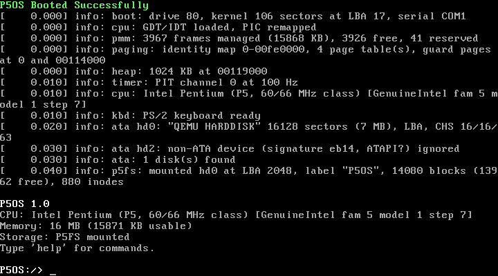

# P5OS — 初代 Intel Pentium / 16 MB RAM 向け小型OS

P5OS は、初代 Intel Pentium（P5, 60/66 MHz）と 16 MB RAM の PC/AT 互換機を対象に
ゼロから書いた 32 ビット保護モードの独自OSです。既存OSのカーネル・ブートローダーは
一切使っていません（GCC / NASM / binutils / QEMU は開発ツールとしてのみ使用）。

```
P5OS Booted Successfully
...
P5OS 1.0
CPU: Intel Pentium (P5, 60/66 MHz class) [GenuineIntel fam 5 model 1 step 7]
Memory: 16 MB (15871 KB usable)
Storage: P5FS mounted
Type 'help' for commands.

P5OS:/> echo Hello, World!
Hello, World!
```



---

## 1. 現在の状態

| Phase | 内容 | 状態 |
|---|---|---|
| 1 起動 | 2段ブートローダー（MBR/フロッピー）、保護モード移行、A20、カーネルロード | 完了 |
| 2 基本カーネル | GDT/TSS、IDT、例外ハンドラ、8259 PIC、8254 PIT、PS/2 キーボード、シェル | 完了 |
| 3 メモリ管理 | E820/E801/88h メモリ検出、物理ページ管理、ページング（ガードページ）、カーネルヒープ | 完了 |
| 4 ストレージ | ATA PIO 読み書き、エラー検出、独自FS「P5FS」、ファイル/ディレクトリ操作 | 完了 |
| 5 安定化 | 自動テスト、長時間稼働、再起動/停止、メモリ量別起動、例外テスト | 完了（QEMU上） |

**検証はすべて QEMU 上で行ったものです。実機（実在の Pentium マシンや各社BIOS）での動作は
未確認であり、保証できません。** 詳細は「8. 既知の制約」を参照してください。

---

## 2. 対象ハードウェアと設計方針

| 項目 | 前提 | 実装上の扱い |
|---|---|---|
| CPU | 初代 Pentium (P5) 60/66 MHz | `-march=pentium` でビルドし、P6以降の命令（CMOV, FCOMI, SSE, UD2, SYSENTER…）が含まれていないことを `make check-isa` で毎回逆アセンブル検査。FPU/MMX/SSE はカーネルで不使用 (`-mgeneral-regs-only`) |
| RAM | 16 MB | E820 → E801 → AH=88h の順で実メモリを検出。16 MB 全域が使えるとは仮定しない。最低要件は 1 MB 超の領域に 512 KB（実質 2 MB 機）。64 MB 超は管理対象外 |
| ページング | 任意 | 4 KB ページの2段ページングのみ（PSE・PAE 不使用） |
| 起動 | レガシー BIOS | INT 13h CHS 読み込み。フロッピー (1.44 MB) と IDE HDD の両方から起動可 |
| 画面 | VGA 互換 | テキストモード 80×25（0xB8000、CRTC カーソル制御） |
| 入力 | PS/2 キーボード | 8042 経由 IRQ1、スキャンコードセット1、US 配列 |
| タイマー | 8253/8254 PIT | チャンネル0、100 Hz |
| 割り込み | 8259A PIC ×2 | 0x20/0x28 にリマップ、スプリアス IRQ7/15 判定 |
| ディスク | IDE ATA | PIO ポーリング、LBA28（LBA非対応ドライブは CHS） |
| 時計 | CMOS RTC | ファイルのタイムスタンプと `date` に使用（読み取りのみ） |
| デバッグ | COM1 | 画面出力とカーネルログを 38400 bps で COM1 へミラー（UART 不在なら自動無効） |
| 省略 | ネットワーク、USB、サウンド、PCI、APIC、ACPI、マルチタスク、ユーザーモード | |

優先順位（確実な起動 → 16 MB 以内 → P5 で実行可能 → 安定性とデバッグ容易性 →
実用的なコマンドライン → 拡張性）に従い、各層は「単純で検証しやすいこと」を優先しています。

---

## 3. ディレクトリ構成

```
p5os/
├── Makefile                 ビルド・実行・テスト
├── README.md                このファイル
├── boot/
│   ├── stage1.asm           MBR/フロッピーブートセクタ (446 バイト以内)
│   └── stage2.asm           第2段: CPU検査, メモリ検出, A20, カーネル読込, 保護モード移行
├── include/                 ヘッダ (types.h, io.h, mm.h, fs.h, p5fs.h, ata.h, display.h ...)
├── kernel/
│   ├── linker.ld            リンカースクリプト (0x100000 にロード)
│   ├── main.c               初期化順序の制御
│   ├── console.c            端末処理 (表示バックエンド非依存)
│   ├── klog.c panic.c system.c
│   ├── arch/                entry.asm isr.asm gdt.c interrupts.c pic.c timer.c cpu.c
│   ├── drivers/             vga_text.c keyboard.c serial.c ata.c rtc.c
│   ├── mm/                  memmap.c pmm.c paging.c heap.c
│   ├── fs/                  p5fs.c
│   ├── lib/                 string.c printf.c errno.c
│   └── shell/               shell.c cmd_sys.c cmd_mem.c cmd_fs.c
├── rootfs/                  HDDイメージの P5FS に最初から入れるファイル
├── tools/
│   ├── mkimage.py           フロッピー/HDD イメージ生成
│   ├── p5fs.py              ホスト側 P5FS 実装 (mkfs / ls / cat / put / check)
│   ├── check_isa.py         P5 非対応命令の検出
│   └── kernel_size.py       カーネルサイズ表示・上限チェック
├── tests/
│   ├── qemu_harness.py      QEMU 制御 (sendkey, VGA メモリ読取, シリアルログ)
│   ├── run_tests.py         自動テスト一式
│   └── results/             テストレポートとスクリーンショット
└── images/                  ビルド済みブートイメージ
    ├── p5os-floppy.img      1.44 MB フロッピー
    └── p5os-hdd.img         約 8 MB IDE HDD (MBR + P5FS パーティション)
```

---

## 4. 開発環境とビルド

### 必要なツール（この環境で確認したバージョン）

| ツール | 確認版 | 備考 |
|---|---|---|
| GCC | 13.3 (Ubuntu) | i686-elf クロスコンパイラは無かったため、ホスト GCC を `-m32 -ffreestanding -nostdlib -nostdinc` で使用。libgcc にも依存しない（64bit 除算は自前） |
| GNU binutils | 2.42 | `ld -m elf_i386`, `objcopy`, `objdump`, `nm` |
| NASM | 2.16.01 | |
| GNU Make | 4.3 | |
| Python 3 | 3.12+ | イメージ生成とテスト。スクリーンショット保存のみ Pillow を使用 |
| QEMU | 8.2.2 (`qemu-system-i386`) | Ubuntu の `qemu-system-x86` パッケージ |

Ubuntu 24.04 の場合: `sudo apt-get install build-essential nasm python3 qemu-system-x86`
（GCC の `-m32` で `stdint` 等のヘッダは使わないため `gcc-multilib` は不要です）

### ビルド

```sh
cd p5os
make            # カーネル, stage1/2, images/*.img を生成し, ISA 検査とサイズ表示
make WERROR=1   # 警告をエラー扱いにしてビルド (現状 警告 0)
make clean      # build/ を削除 (images/ は残す)
make distclean  # images/ も削除
```

`make` の最後に次のような検査結果が出ます:

```
check-isa: OK (14166 instructions, none beyond the P5 instruction set)
kernel: image 54168 bytes (106 sectors), bss 45056 bytes, memory 0x100000-0x119000 (100 KB)
```

---

## 5. 起動方法

### QEMU

```sh
make run          # HDD から起動 (+ 2台目に書き込みテスト用データディスク build/data.img)
make run-floppy   # フロッピーから起動, データディスクを hd0 に接続
make run-isapc    # PCI の無い ISA PC モデルでフロッピー起動
make debug        # GDB 待ち受け (-s -S)
```

すべて `-cpu pentium -m 16` で起動します。初代 P5 (60/66 MHz) の CPUID により近づけるには:

```sh
qemu-system-i386 -cpu pentium,model=1,stepping=7,-mmx,-apic -m 16 \
    -drive file=images/p5os-hdd.img,format=raw -serial stdio
```

> QEMU の `pentium` モデルそのままでは family 5 / **model 4**（P55C 相当）で MMX と APIC の
> フラグが立っています。上記オプションで CPUID の EDX は 0x1BD（実機 P5-60/66 は 0x1BF、
> 差は VME ビットのみ）になります。いずれにしても QEMU (TCG) は命令単位のエミュレーションで、
> P5 のタイミング・パイプライン・FDIV バグ等は再現しません。

### 実機向けの書き込み（注意）

* フロッピー: `dd if=images/p5os-floppy.img of=/dev/fdX bs=512`（1.44 MB 2HD）
* HDD: `dd if=images/p5os-hdd.img of=/dev/sdX bs=512` は **書き込み先ディスクの内容をすべて破壊します**。
  専用のディスクでのみ行ってください。ディスク先頭 2048 セクタがブート領域、その後ろが P5FS です。

---

## 6. 使い方（シェルコマンド）

| コマンド | 説明 |
|---|---|
| `help` | コマンド一覧 |
| `ver` | バージョン, ビルド日時, CPU |
| `mem` / `mem map` | メモリ使用状況 / BIOS メモリマップ |
| `memtest [heap\|pages\|oom]` | ヒープ乱数確保解放・ページ書込検証・メモリ枯渇検出のセルフテスト |
| `cls` | 画面クリア |
| `echo <text>` | 文字列表示（空白はそのまま保持） |
| `uptime` | 稼働時間 |
| `date` | CMOS 時計（UTC とみなす） |
| `cpu` | CPUID 情報, IRQ 回数, キー取りこぼし数 |
| `dmesg` | カーネルログ（8 KB リングバッファ） |
| `reboot` / `halt` | 再起動（8042 リセット→トリプルフォールト） / 停止 |
| `ls [path]` | ファイル一覧（サイズ, 更新日時） |
| `cat <file>` | ファイル表示 |
| `write <file> [text]` | ファイル作成/上書き。text 省略時は複数行入力（`.` だけの行で保存、Ctrl+C で中止） |
| `append <file> [text]` | 追記 |
| `mkdir <dir>` / `rmdir <dir>` | ディレクトリ作成 / 削除（空のみ） |
| `rm <path...>` | ファイルまたは空ディレクトリ削除 |
| `cd [dir]` / `pwd` | カレントディレクトリ |
| `df` / `fsck` | 使用量 / 整合性チェック（読み取りのみ） |
| `disks` / `mount [hdN]` | IDE ディスク一覧 / マウント先の表示・切替 |
| `sector <hdN> <lba>` | セクタの16進ダンプ（読み取りのみ） |
| `disktest` | 境界サイズ・間接ブロック・最大サイズのファイル書込/読戻し検証 |
| `crash <kind>` | 例外処理の試験（div0 gpf ud null stack panic）— **システムが停止します** |

キー操作: ↑↓ 履歴（16件）, Backspace, Ctrl+C 行取消, Ctrl+L 画面クリア, Ctrl+Alt+Del 再起動。
パスは絶対/相対、`.` `..` 対応。`"..."` で空白を含む引数を指定できます。

ファイルシステムが見つからない場合、ストレージ系コマンドは
`not available - no P5FS file system mounted ...` と表示して何もしません。

---

## 7. 内部設計

### 7.1 起動シーケンス

1. **stage1** (`boot/stage1.asm`, LBA 0): BIOS が 0x7C00 にロード。CS:IP を正規化し、
   フロッピーは 1.44 MB 固定ジオメトリ（INT13/08 はメディアでなくドライブ種別を返すことがあるため）、
   HDD は INT13/08 でジオメトリを取得。stage2 の 16 セクタを1セクタずつ（最大5回リトライ＋リセット）
   0x7E00 に読み込み、シグネチャ `P5S2` を確認してジャンプ。8086/186 命令のみ使用。
2. **stage2** (`boot/stage2.asm`, LBA 1–16):
   * テキストモード3設定、CPU 検査（8086/286 を判別して拒否、CPUID 有無を記録）
   * メモリ検出: E820（ACPI3 拡張属性考慮）→ E801 → AH=88h、INT 12h
   * 1 MB 超に最低 512 KB 無ければエラー表示
   * A20: 既に有効か確認 → BIOS (INT15 2401) → 8042 出力ポート → ポート 0x92。各方式の後に
     0x000500 / 0x100500 のラップアラウンドで実際に検証
   * カーネルを 0x10000 へ読み込み。1回の INT 13h はトラック内に限定し、64 KB の DMA 境界を
     跨がないよう分割。失敗が続く場合は1セクタ単位へ自動フォールバック
   * PIC 全マスク・NMI 無効化 → フラット GDT → CR0.PE → 32 bit コードで 0x100000 へコピー → ジャンプ
   * どの段階の失敗も原因を画面表示し、キー入力で再起動
3. **kernel** (`kernel/main.c`): BSS クリア → シリアル/VGA → ブート情報コピー → フロッピーモーター停止 →
   GDT(+TSS×2) → IDT → PIC → PMM → ページング → ヒープ → PIT → `sti` → CPUID → キーボード →
   ATA 検出 → P5FS マウント → シェル

### 7.2 メモリマップ（16 MB, QEMU 実測）

| 物理アドレス | 用途 |
|---|---|
| 0x00000000–0x00000FFF | IVT/BDA。**ページング後は非マップ（NULL 参照検出）** |
| 0x00000800 | stage2 → カーネルのブート情報（カーネルが起動直後にコピー） |
| 0x00001000 | E820 マップ（同上） |
| 0x00010000–0x0009FBFF | 起動時はカーネル仮置き場、起動後は空きページとして再利用 |
| 0x000A0000–0x000FFFFF | VGA メモリ・BIOS ROM（キャッシュ無効でマップ） |
| 0x00100000–0x00118FFF | カーネル 100 KB（コード+データ 53 KB, BSS 44 KB; スタック 16 KB と直下の**ガードページ**を含む） |
| 0x00119000– | カーネルヒープ 1 MB（RAM が少ない場合は空きの 1/4 に縮小、最低 64 KB） |
| 以降 | 物理ページアロケータの空き領域 |
| 0x00FE0000–0x00FFFFFF | BIOS 予約（E820 で除外） |

起動直後の使用量（16 MB 時）: カーネル 100 KB + ページテーブル 20 KB + ヒープ 1 MB ≒ 1.2 MB、
空き 14,664 KB。`mem` で常時確認できます。

* **物理ページ管理** (`mm/pmm.c`): 4 KB 単位のビットマップ（64 MB 分 2 KB）。E820 の usable 領域だけを
  空きにし、重なる予約領域・先頭 64 KB・カーネルを除外。連続確保対応、二重解放検出。
* **ページング** (`mm/paging.c`): 全 RAM を恒等マップ。ページ0、カーネルスタック直下、RAM の外は
  非マップ。スタックオーバーフローは #PF → #DF となり、#DF は専用 TSS（タスクゲート、別スタック）で
  処理するため、トリプルフォールトで黙って再起動せず診断画面が出ます。
* **ヒープ** (`mm/heap.c`): ファーストフィット、16 バイトヘッダ（マジック値・サイズ・前ブロック）、
  解放時に前後と結合。不正ポインタ・二重解放・後続ブロック破壊を検出してパニック。
  確保失敗は NULL を返し、ログと失敗回数カウンタに記録。

### 7.3 割り込み・例外

* 例外 0–31 はすべてパニック画面（例外名、エラーコード、全レジスタ、CR0/2/3、EBP チェーンの
  バックトレース、稼働時間、直近ログ）。ページフォルトは NULL 参照 / ガードページ / 非マップ領域を判別。
* NMI はパリティエラー / I/O チャネルチェックを判別して表示。`int3` はログのみで続行。
* IRQ: 0 = PIT（100 Hz、スタックカナリア検査）、1 = キーボード。IDE は割り込み無し（nIEN）。

### 7.4 ディスクレイアウトと P5FS

```
HDD イメージ (16 ヘッド × 63 セクタのシリンダ境界に揃えたサイズ)
LBA 0        stage1 + MBR パーティション表 (#1: type 0x7F, LBA 2048 から末尾まで)
LBA 1-16     stage2
LBA 17-      カーネル (最大 1024 セクタ = 512 KB)
LBA 2048-    P5FS
```

フロッピーは同じブート領域のみ（FS 無し）。P5FS はディスク全体（データディスク）にも置けます。
起動時に hd0→hd3 の順に「ディスク全体の P5FS」→「type 0x7F パーティション」を探してマウントします。

P5FS v1（`include/p5fs.h` / `tools/p5fs.py`）: 512 B ブロック、ブロック0=スーパーブロック（チェックサム付き）、
割り当てビットマップ、64 B inode（直接12 + 間接1 → 最大 70 KB/ファイル）、32 B ディレクトリエントリ
（名前 27 文字）、各ディレクトリに `.` と `..`。

**メタデータ保護**: キャッシュ無しのライトスルー。ファイル内容の更新は copy-on-write で
「新ブロック書込 → ビットマップ書込 → inode 書換（切替点）→ 旧ブロック解放」の順。
作成は inode → ディレクトリエントリ、削除はエントリ → inode → ブロックの順。どこで中断しても
起こり得るのは「ブロックのリーク」か「どこからも参照されない inode」だけで、二重所有や
解放済みブロックの参照は発生しません（`fsck` で検出可能）。スーパーブロックは mkfs 後に書き換えません。
マウント時にスーパーブロックの全フィールド・メタデータ領域のビットマップ・ルート inode を検証し、
異常なら**マウントを拒否**します。

### 7.5 GUI への拡張性

画面出力は `include/display.h` の `struct display_ops`（putcell / scroll_up / clear / set_cursor）だけを
経由します。`kernel/console.c` とシェルはこのテーブルしか知らないため、VGA グラフィックモード
（例: mode 12h 640×480×16 やモード 13h）のバックエンドを追加し `console_init()` に渡すだけで
差し替えられます。

---

## 8. デバッグ方法

* **シリアルログ**: 画面出力とカーネルログはすべて COM1 にも出ます。`make run` は `-serial stdio`。
  実機ではヌルモデムケーブル 38400 8N1。
* **dmesg**: タイムスタンプ付きカーネルログ（ATA エラー、メモリ不足、fsck 結果など）。
* **パニック画面**: 赤背景でレジスタ・バックトレース・直近ログを表示し停止。
  バックトレースのアドレスは `addr2line -f -e build/kernel.elf 0x00104647` でソース行に変換できます。
  シンボルは `build/kernel.map` にもあります。
* **GDB**: `make debug` → 別端末で `gdb build/kernel.elf -ex 'target remote :1234'`
* **QEMU の割り込みログ**: `qemu-system-i386 ... -d int,cpu_reset -D qemu.log`（#DF/トリプルフォールト調査に有用）
* **ディスク内容の確認**: `python3 tools/p5fs.py check|tree|ls|cat images/p5os-hdd.img ...`、
  OS 内では `sector hd0 2048`。

---

## 9. 動作確認手順（テスト）

```sh
make                                # クリーンでも可: make clean && make
python3 tests/run_tests.py          # 全テスト (約1.5分 + 2分の長時間稼働テスト)
python3 tests/run_tests.py --soak 600   # 長時間稼働テストを10分に
python3 tests/run_tests.py -k fs    # 名前に fs を含むテストだけ
```

テストはイメージを一時ディレクトリへコピーして実行するため `images/` は変更されません。
書き込みテストは専用の仮想ディスク（テストごとに新規作成）または HDD イメージのコピーで行います。
キー入力は QEMU モニタの `sendkey`（エミュレートされた 8042 を経由するので実際のキーボード
ドライバを通ります）、画面内容は VGA テキストメモリ 0xB8000 を直接読み取って検証しています。
結果は `tests/results/test-report.txt` に保存されます。

| テスト | 内容 |
|---|---|
| boot_hdd_16mb_p5 | P5 相当 CPU・16 MB で HDD 起動、起動メッセージ・CPU・メモリ・FS 表示を画面で確認 |
| boot_floppy_data_disk | フロッピー起動 + データディスクの自動マウント |
| boot_isapc_no_pci | PCI の無い ISA PC モデルで起動・ファイル読み出し |
| memory_sizes | 1 MB（エラー表示で停止すること）, 2/4/8/16/64 MB で起動・容量表示 |
| shell_commands | help 一覧, ver, echo, uptime, mem, cpu, dmesg, cls, 履歴, Backspace, Ctrl+C, 未知コマンド |
| memtest | ヒープ乱数試験・ページ書込検証・メモリ枯渇検出、前後でヒープ使用量が一致（リーク無し） |
| fs_operations | write/append/cat/mkdir/cd/pwd/ls/rm/rmdir/fsck と各種エラー、複数行 write、ホスト側で整合性と内容を再検証 |
| fs_disktest_persistence | disktest（0〜70 KB, 上限+1 の拒否, リーク無し）、再起動・電源再投入後もファイルが残ること |
| fs_mount_switch | hd0 ⇔ hd1 の切替、存在しないディスク指定時のエラー |
| reboot | `reboot` と Ctrl+Alt+Del、同一セッションで計6回の起動 |
| halt | 停止メッセージ、CPU が HLT 状態、以後キーに反応しないこと |
| exceptions | div0/#GP/#UD/NULL/スタックオーバーフロー/明示パニックがそれぞれ正しい診断画面になり、リセットしないこと |
| soak | 指定時間 write/append/fsck を繰り返し、定期的に memtest/disktest。稼働時間のずれ、ヒープリーク、スタック使用量、ログファイル内容、ホスト側 fsck を確認 |

手動で確認する場合は `make run` で起動し、上記コマンドを入力してください。

---

## 10. 既知の制約と未実装機能

**検証範囲**
* 動作確認は QEMU 8.2.2 (TCG) の `pentium` モデル（および model=1/-mmx/-apic 指定）、`pc`(i440FX) と
  `isapc` マシン、SeaBIOS のみ。LBA 非対応ドライブ向けの CHS 経路は QEMU では通常通らないため、
  `make EXTRA_CFLAGS=-DATA_FORCE_CHS` で CHS を強制したビルドを作り、`disktest` とホスト側検証で確認しました。**実機・他の BIOS では未検証**です。QEMU は P5 の実行速度や
  タイミング、FDIV/F00F 等のエラッタ、古い IDE ドライブの癖（スピンアップ時間、LBA 非対応など）を
  再現しません。60 MHz と 66 MHz の違いはカーネルの動作に影響しない設計（時間計測は PIT 基準、
  CPU クロック依存のループ無し）ですが、実機では確認していません。
* 実機の古い BIOS / ハードウェアを想定して、次の点を明示的に扱っています（いずれも QEMU では
  差が出ないため、コードレビューで確認したものです）: 8042 経由の A20 有効化で残留スキャンコードを
  捨て、リセット線 (bit0) を必ず 1 に保つ / INT 12h・E801 の戻り値の妥当性確認 / ポート 0x70 を読まない /
  CHS 専用ドライブへの INITIALIZE DEVICE PARAMETERS 発行 / IDENTIFY が対応を示す場合だけ FLUSH CACHE /
  inode 書込でエラーが報告されても実際に書かれていた場合に二重所有を起こさない処理 / フロッピーモーター停止。
* `-cpu pentium` の CPUID は model 4 (P55C) 扱い。P5 (model 1) 表示はオプション指定時のみ確認。

**未実装・制限**
* マルチタスク、ユーザーモード、システムコール、プログラムのロード・実行（シェル内蔵コマンドのみ）
* GUI（表示層は差し替え可能な構造のみ用意）
* フロッピーディスクドライバ（フロッピーは起動専用。FS は IDE ディスクのみ）
* OS 内からのフォーマット（`mkfs`）— ホストの `tools/p5fs.py mkfs` を使用
* P5FS: 最大ファイル 70 KB、名前 27 文字（ASCII）、パーミッション・リンク・タイムゾーン無し、
  ファイル名変更/コピーコマンド無し、ジャーナル無し（書き込み順序で整合性を保つ方式）、
  ファイルシステム最大 128 MB
* ATA: PIO ポーリングのみ（DMA・IRQ・LBA48・ATAPI 非対応）、最大 4 台（プライマリ/セカンダリ）
* キーボード: US 配列のみ（日本語 106/109 配列の記号位置は異なる）、キーボード LED 未制御、
  左右カーソルキーでの行内編集は未対応
* メモリ: 64 MB 超は使用しない、カーネルヒープは起動時に固定サイズ（最大 1 MB）
* 時刻: CMOS RTC を UTC とみなし、書き込み・タイムゾーン設定は無し
* 電源断: ACPI/APM 非対応のため `halt` は CPU 停止のみ（電源は手動で切る）
* COM1 は出力専用（シリアルコンソール入力は無し）
* ディスクの読み書き速度は最適化していない（1 ブロック単位のライトスルー）
